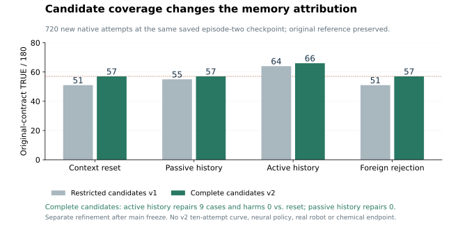
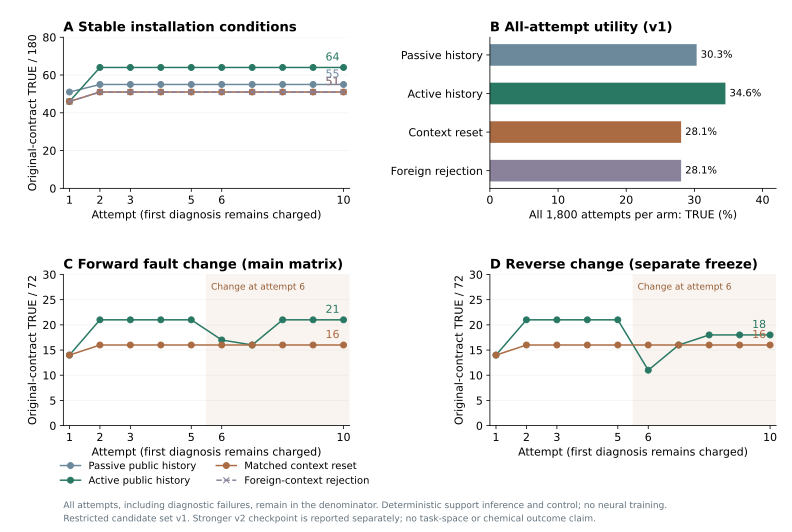
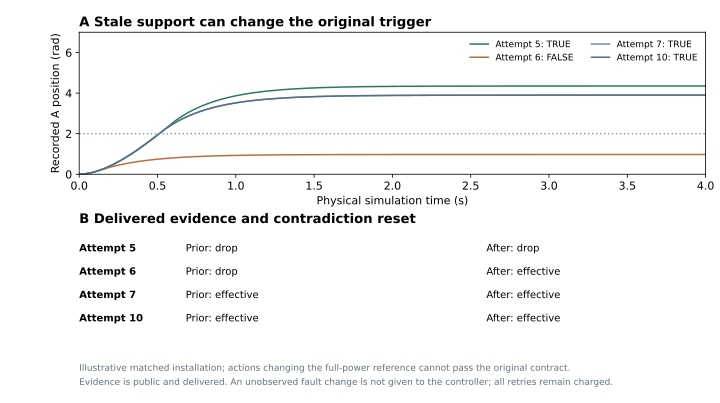

# 公开历史、诊断成本与陈旧支持：多尝试组件实验

状态：本轮机械组件执行与独立审计通过；完整VLA、真实机器人和化学实验仍为MAJOR_OPEN。新增10,800条原生轨迹、10,810,800个物理样本；包括8,640次主矩阵、另冻结的1,440次反向扩展和720次候选集合补测。三个冻结不能合称一个预注册矩阵。44次开发／预检执行不计入以上新增数。没有新RGB、LLM采集或权重训练。

## 当前回答了什么

此前提前恢复51/180与特权保持参照图66/180的15例差距，不能直接视作学习空间。本轮先让同一安装的真实公开反馈在下一次尝试使用，分别测试主动诊断、被动复用、清空及拒绝其他安装来源。又发现主矩阵控制候选覆盖不足，单独冻结补测以修正归因。

物理模拟为两个驱动过程、串行选择性设备通道和独立全局继电器。A、B均有独立事件后的停止窗口，B还必须保持连续运行。故障为无故障、首次命令丢失、持续主执行器失效；控制器不能读取真值。已交付的公开速度、功率及ACK提供故障支持，接管遮蔽不能被当成原执行器成功证据。响应模型在当前尝试八对已交付样本后冻结。

## 候选完整的配对检查点：优先阅读

720次新执行沿用主矩阵真实第1次尝试产生的第2次历史输入；同一冻结动作族向所有臂开放全局单独停止和B后全局停止。不重跑、不替换首轮，也不编造免费标签。

| 第2次检查点 | v1 TRUE / FALSE / UNKNOWN | v2 TRUE / FALSE / UNKNOWN | v2对清空历史：修复 / 损害 |
| --- | --- | --- | --- |
| 清空上下文 | 51 / 129 / 0 | 57 / 123 / 0 | — |
| 被动公开历史 | 55 / 125 / 0 | 57 / 123 / 0 | 0 / 0 |
| 主动公开历史 | 64 / 116 / 0 | 66 / 114 / 0 | 9 / 0 |
| 来源不匹配拒绝 | 51 / 129 / 0 | 57 / 123 / 0 | 0 / 0 |

被动历史的表面收益被更完整候选解释。主动历史在相同候选集合下仍修复9例，但这是已知故障族的规则适应。180例逐例对照此前特权扩展图：主动历史通过的66例恰好为图内可达例，失败的114例恰好为该图不可达例。所有检查点保持原参照和B连续性；没有证明所有动作策略的最优性。v2仅执行一个检查点，没有十次累计或故障切换曲线。

## 主矩阵v1：诊断计入全部尝试

稳定安装180例×10次×4臂，共7,200次。故障、合同和设备响应在安装内保持。

| 臂 | 第1次TRUE / 180 | 第2、3、5、10次TRUE / 180 | 十次累计TRUE / FALSE / UNKNOWN | 诊断次数 |
| --- | --- | --- | --- | --- |
| 被动公开历史 | 51 | 55 | 546 / 1254 / 0 | 0 |
| 主动公开历史 | 46 | 64 | 622 / 1176 / 2 | 180 |
| 清空上下文 | 46 | 51 | 505 / 1293 / 2 | 180 |
| 来源不匹配拒绝 | 46 | 51 | 505 / 1293 / 2 | 180 |

v1主动与清空的首轮诊断相同，第2至10次13修复0损害，全部尝试累计34.6%对28.1%。这些数使用受限候选，不应代替上面的v2同候选结论。来源控制拒绝来自其他安装的真实记录，验证来源边界；它不测试VLM对文字打乱的敏感性。主动与被动臂的诊断策略不同，不能把二者全部差值归因给记忆。

## 故障切换：适应会损害原合同

主矩阵另含72新配置×10次×2臂的正向切换。第6次在无故障→首条丢失→持续故障→无故障的循环改变条件。主矩阵之后另冻结反向循环扩展，72×10×2，补齐首条丢失→无故障这个危险变化。

| 切换方向 | 第6次主动 / 清空 TRUE，分母72 | 第6次配对修复 / 损害 | 十次累计主动 / 清空 TRUE，分母720 |
| --- | --- | --- | --- |
| 正向，主矩阵 | 17 / 16 | 1 / 0 | 194 / 158 |
| 反向，另冻扩展 | 11 / 16 | 1 / 6 | 179 / 158 |

反向的6例损害都改变或消除了原参照。其中2例原始重新计时标签为TRUE，但原合同仍FALSE。旧的“首条会丢失”支持可以使控制器在原触发事件前提交A命令；当首条重新有效，就改变了任务本身。独立参照保护防止假通过，但没有预先阻止执行。遮蔽反馈可能使错误支持持续相容，不能把集合交冲突重置当成充分失效检测。

## 独立验收与时钟范围

各冻结源与父证据哈希绑定。逐次原生状态、命令FIFO和私有物理效果重建，公开控制完整回放，故障支持及来源／版本／交付时刻独立重算；原参照、实际停止窗口、B连续性独立评分。主矩阵、反向扩展和720检查点的原生重建最大误差均0，B连续性全部10,800次TRUE。UNKNOWN与失败保留；化学联合标签未获证据。

每次物理时长10s、采样间隔10ms，下一次全局起点相距11s。尾部反馈按声明交付时间进入下一轮；间隔不推进动力学。主机计算也不自动推进过程，因此这不是持续现实时间机器人验证。配置是确定性机械开发案例，不是独立实验批次；不使用神经策略误差条或推断总体统计优势。

首轮审计曾遇到JSON列表与内存元组表示差异，以及新响应配置未传入独立重建器的问题。修复发生在主执行冻结前，原失败日志保留并复用40条已完成预检轨迹；未改控制或重跑以筛选成功。本轮图表兼容性及归因脚本字段错误只影响派生输出，原失败日志保留，物理结果未变。

公开网页发布摘要、图和ICML增量PDF；科研工作区保存逐条原始轨迹及审计哈希，当前公共仓库不是完整原始数据发布。

方法：[数学表述](FORMULATION_cn.md)、[方法决策v5](METHOD_DECISION_v5_cn.md)、[近邻研究](RELATED_WORK_cn.md)。证据：[主摘要](RESULTS_SUMMARY.json)、[全尝试分析](ANALYSIS.json)、[候选补测](CANDIDATE_FOLLOWUP_SUMMARY.json)、[逐例图范围归因](FOLLOWUP_ATTRIBUTION.json)。下一步：[准入协议](NEXT_EXPERIMENT_PROTOCOL_v1.json)。
